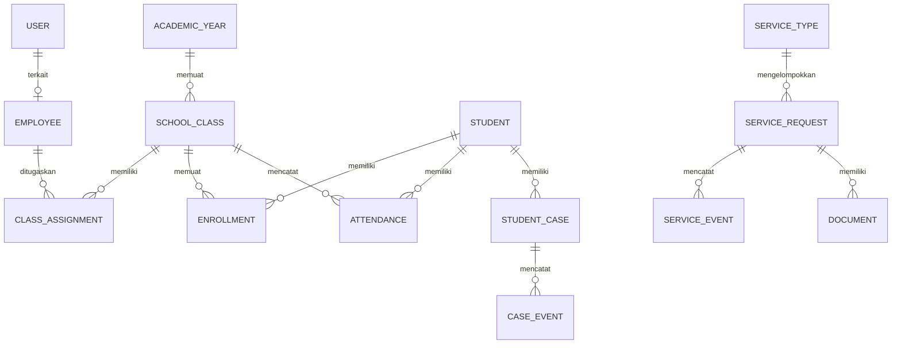

# Database Design Document (DBD)

**Status:** rancangan konseptual awal; nama tabel, kardinalitas, batasan, dan retensi diselaraskan dengan kebutuhan implementasi Django Ninja. Django migrations menjadi sumber kebenaran skema implementasi.

## 1. Prinsip desain data

- **Identitas bersama:** Gunakan primary key (Auto ID atau UUID) konsisten lintas modul dengan relasi Foreign Key eksplisit.
- **Transaksi atomik:** Operasi mutasi yang melibatkan relasi multi-entitas (misal pencatatan kehadiran kelas, transisi status beserta pencatatan *event*) wajib dibungkus dalam blok transaksi database atomik (`transaction.atomic`).
- **Penyimpanan privat berkas:** Dokumen arsip dan lampiran permohonan tidak disimpan di root statis publik. Basis data hanya menyimpan metadata (kunci penyimpanan acak/UUID, nama berkas asli, MIME type, ukuran, dan relasi permohonan).
- **Audit trail bertingkat:** Menggunakan `django-simple-history` untuk snapshot riwayat model bisnis terpilih, tabel `ActivityLog` untuk jejak keamanan/akses, dan tabel relasional *event* untuk urutan peristiwa bisnis.
- **Penghapusan data:** Hindari hard delete pada data transaksi dan data master yang sudah memiliki referensi riwayat; terapkan proteksi `on_delete=models.PROTECT` atau penandaan status aktif/nonaktif.

## 2. Entitas inti sistem

| Entitas | Atribut utama | Aturan & batasan integritas |
|---|---|---|
| User | id, username, password_hash, is_active, is_staff, date_joined | Terintegrasi dengan Django Group untuk multi-peran; tanpa kata sandi terbuka di log |
| Employee | id, user_id (FK nullable, unique), nip, name, status, created_at | Profil pegawai/guru; opsional terhubung ke User jika memiliki hak akses sistem |
| AcademicYear | id, name, start_date, end_date, is_active, created_at | Tanggal mulai tidak boleh melebihi tanggal selesai; hanya satu tahun ajaran aktif secara default |
| SchoolClass | id, academic_year_id (FK), name, level, created_at | Unik berdasarkan kombinasi `(academic_year_id, name)` |
| Student | id, student_number (NIS/NISN unik), name, gender, status, created_at | Identitas siswa unik dan konsisten di seluruh modul |
| Enrollment | id, student_id (FK), class_id (FK), start_date, end_date | Riwayat penempatan kelas siswa; tidak boleh ada dua penempatan aktif bersamaan untuk siswa yang sama |
| ClassAssignment | id, employee_id (FK), class_id (FK), role, start_date, end_date | Penugasan guru mata pelajaran atau wali kelas; dasar otorisasi akses kelas di sisi server |
| Attendance | id, student_id (FK), class_id (FK), date, status, note, recorded_by_id (FK User), created_at, updated_at | Constraint unik `(student_id, class_id, date)`; status: `HADIR`, `SAKIT`, `IZIN`, `ALPA` |
| StudentCase | id, student_id (FK), title, summary, status, assigned_to_id (FK Employee), version, created_at, updated_at | Status: `BARU`, `DIPROSES`, `SELESAI`, `DIBATALKAN`; kolom `version` untuk kontrol konkurensi optimistik |
| CaseEvent | id, case_id (FK), action, initial_status, final_status, note, actor_id (FK User), created_at | Catatan kronologis tindakan kasus; dicatat dalam transaksi yang sama dengan perubahan status |
| ServiceType | id, code, name, description, is_active | Referensi master jenis layanan administrasi persuratan tata usaha |
| ServiceRequest | id, request_number, service_type_id (FK), applicant_name, student_id (FK nullable), status, created_by_id (FK User), version, created_at, updated_at | Status: `DIAJUKAN`, `DIPROSES`, `MENUNGGU_PERSETUJUAN`, `DISETUJUI`, `DITOLAK`, `SELESAI`; kolom `version` untuk kontrol konkurensi optimistik |
| ServiceEvent | id, request_id (FK), action, initial_status, final_status, note, actor_id (FK User), created_at | Jejak tahapan proses dan persetujuan permohonan |
| Document | id, request_id (FK), storage_key, original_filename, mime_type, file_size, uploaded_by_id (FK User), created_at | Metadata berkas privat; storage_key berupa UUID acak di sistem berkas lokal |
| ActivityLog | id, actor_id (FK User nullable), action, resource_type, resource_id, request_id, ip_address, created_at | Log aktivitas audit sistem; data kredensial dan rahasia disaring sebelum disimpan |
| HistoricalRecords | history_id, history_date, history_user_id, history_type, snapshot kolom | Dikelola otomatis oleh `django-simple-history` pada model `Attendance`, `StudentCase`, dan `ServiceRequest` |

## 3. Hubungan konseptual (ERD)

## 4. Integritas dan strategi indeks

- **Unique Constraints:**
  - `SchoolClass`: `unique_together = ('academic_year', 'name')`
  - `Attendance`: `unique_together = ('student', 'class_id', 'date')`
  - `Student`: `student_number` bersifat unik.
  - `ServiceRequest`: `request_number` bersifat unik.
- **Indeks Kueri (Database Indexing):**
  - `Attendance`: indeks komposit pada `(class_id, date)` untuk kueri form absensi kelas harian, dan `(student_id, date)` untuk rekap kehadiran per siswa.
  - `Enrollment`: indeks pada `(class_id, student_id)` dan `(student_id, start_date, end_date)` untuk validasi keaktifan siswa.
  - `ClassAssignment`: indeks pada `(employee_id, class_id, role)` untuk pengecekan otorisasi guru.
  - `StudentCase`: indeks pada `(status, created_at)` dan `(assigned_to_id, status)` untuk filter antrean kesiswaan.
  - `ServiceRequest`: indeks pada `(status, created_at)` dan `(service_type_id, status)` untuk filter antrean tata usaha.
  - `CaseEvent` & `ServiceEvent`: indeks pada `(parent_id, created_at)` untuk mengurutkan riwayat kronologis secara cepat.

## 5. Audit trail dan bulk history

- **Mekanisme snapshot model:** Model `Attendance`, `StudentCase`, dan `ServiceRequest` dipantau oleh `HistoricalRecords()`.
- **Penanganan operasi massal (Bulk History):** Pemanggilan `bulk_create` atau `bulk_update` bawaan Django melewati sinyal model `post_save`. Oleh karena itu, operasi penyimpanan kehadiran kelas harian wajib memanggil utilitas `simple_history.utils.bulk_create_with_history` atau `bulk_update_with_history` di dalam blok transaksi atomik yang sama.
- **Konteks aktor:** Mengisi atribut aktor (`_history_user`) secara eksplisit di service layer dari objek `request.auth` (pengguna terautentikasi JWT) agar jejak audit tidak bernilai null.

## 6. Kamus data awal

| Entitas.field | Tipe data | Wajib | Keterangan & validasi |
|---|---|---|---|
| Student.student_number | VARCHAR(30) | Ya | Nomor Induk Siswa/NISN unik, dibersihkan dari spasi liar |
| Student.name | VARCHAR(150) | Ya | Nama lengkap siswa |
| AcademicYear.start_date | DATE | Ya | Tanggal mulai tahun ajaran |
| AcademicYear.end_date | DATE | Ya | Tanggal selesai tahun ajaran (wajib > start_date) |
| Enrollment.start_date | DATE | Ya | Tanggal penempatan siswa di kelas |
| Enrollment.end_date | DATE | Tidak | Tanggal selesai penempatan; null berarti penempatan aktif |
| Attendance.date | DATE | Ya | Tanggal absensi (tidak boleh melampaui tanggal hari ini) |
| Attendance.status | VARCHAR(10) | Ya | Pilihan: HADIR, SAKIT, IZIN, ALPA |
| Attendance.recorded_by | FK User | Ya | Pengguna yang melakukan input absensi |
| StudentCase.status | VARCHAR(20) | Ya | Pilihan: BARU, DIPROSES, SELESAI, DIBATALKAN |
| StudentCase.version | INTEGER | Ya | Dimulai dari 1, bertambah 1 setiap pembaruan (optimistic locking) |
| ServiceRequest.status | VARCHAR(30) | Ya | Status alur tata usaha |
| ServiceRequest.version | INTEGER | Ya | Dimulai dari 1, bertambah 1 setiap pembaruan (optimistic locking) |
| Document.storage_key | VARCHAR(100) | Ya | Nama file UUID privat di filesystem |
| Document.mime_type | VARCHAR(100) | Ya | MIME type terverifikasi dari header/magic bytes |
| ActivityLog.request_id | VARCHAR(50) | Tidak | Request ID pelacakan observability |

## 7. Aturan integritas detail

1. **Multi-peran pengguna:** Pengguna dapat terdaftar pada lebih dari satu grup peran Django (misal `Guru` dan `Wali Kelas`). Otorisasi server mengevaluasi gabungan izin aktif terhadap objek yang diminta.
2. **Validasi penempatan siswa:** Sebelum absensi disimpan, sistem memverifikasi bahwa seluruh siswa dalam daftar memiliki catatan `Enrollment` aktif pada tanggal absensi yang dipilih.
3. **Pencatatan riwayat status:** Setiap perubahan status pada `StudentCase` dan `ServiceRequest` wajib menyertakan pencatatan satu baris pada tabel event terkait (`CaseEvent` atau `ServiceEvent`) dalam transaksi yang sama.
4. **Isolasi berkas:** Berkas fisik tidak boleh diakses langsung lewat URL publik. Penghapusan rekaman permohonan harus diatur agar tidak meninggalkan berkas fisik yatim (*orphan files*).

## 8. Penanganan konkurensi (Concurrency Control)

- **Optimistic Locking:** Pada entitas `StudentCase` dan `ServiceRequest`, setiap permintaan pembaruan status atau tindakan menyertakan `expected_version`. Jika `version` pada basis data tidak sama dengan `expected_version`, kueri pembaruan akan gagal dan server mengembalikan HTTP 409 Conflict. Hal ini mencegah dua pengguna menimpa keputusan proses yang sama.
- **Transaksi atomik absensi:** Seluruh baris kehadiran satu kelas disimpan secara serentak. Jika satu siswa gagal divalidasi (misal siswa telah mutasi), seluruh transaksi dibatalkan (*all-or-nothing*).

## 9. Data uji sintetis

Pengujian sistem menggunakan fixture data sintetis (nama samaran, nomor induk fiktif, kelas simulasi) yang mencakup:
- Skenario normal (kelas dengan 30 siswa, kehadiran lengkap).
- Skenario batas (siswa pindah kelas di tengah semester, pembetulan status kehadiran hari sebelumnya).
- Skenario akses terlarang (guru mencoba mencatat kehadiran kelas di luar penugasannya).
- Tidak ada data pribadi riil atau kredensial nyata yang dimasukkan ke repositori atau berkas pengujian.

## 10. Daftar verifikasi migrasi basis data

- [ ] Skema awal terbuat melalui Django migrations tanpa dependensi sirkular.
- [ ] Constraint unik dan indeks komposit terverifikasi pada SQLite dan PostgreSQL.
- [ ] Utilitas bulk history teruji menghasilkan baris riwayat pada tabel history saat operasi massal.
- [ ] Prosedur backup dan restore basis data beserta folder dokumen privat terdokumentasi dan teruji.
