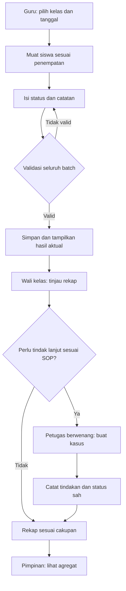
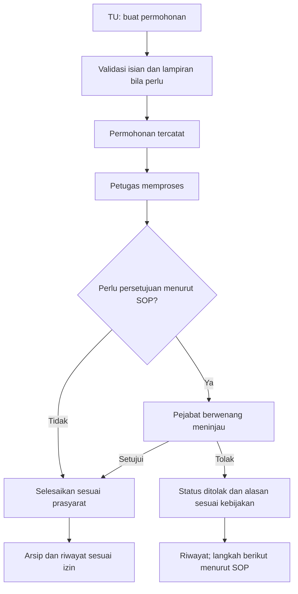

# UI/UX Design Document (UID)
## Sistem Informasi Enterprise Administrasi SMA Negeri 1 Bunut

| Metadata | Nilai |
|---|---|
| Versi | 1.0 |
| Tanggal | 12 November 2026 |
| Status | PROPOSED: DESIGN_SPEC_READY_FOR_REVIEW |
| Cakupan | SPA administrasi internal sekolah, enam peran pengguna |
| Dokumen acuan | PRD, TRD, AFD, DBD, BSD, IPD |
| Target | Antarmuka institusional, responsif, mudah digunakan, aksesibel, konsisten dan siap diimplementasikan secara bertahap |

> Dokumen ini menetapkan standar desain usulan, bukan bukti persetujuan sekolah, desain Figma yang sudah dibuat, atau hasil uji pengguna. PRD dan SOP tervalidasi menentukan ruang lingkup dan hak akses; BSD/OpenAPI menentukan kontrak data; UID menentukan presentasi dan interaksi. Jika bertentangan, selesaikan melalui review lintas dokumen, bukan menambah fitur secara diam-diam. Seluruh contoh data untuk rancangan menggunakan data sintetis.

## 1. Tujuan dan arah desain

Desain harus membantu guru mencatat kehadiran dengan cepat, wali kelas meninjau rekap, kesiswaan menangani kasus, tata usaha memproses layanan, administrator mengelola referensi, dan pimpinan membaca informasi lintas unit sesuai kewenangan. Prioritas adalah ketepatan, keterbacaan, efisiensi kerja, kejelasan status, dan rasa percaya; estetika mendukung tugas, bukan menggantikannya.

**Arah visual:** modern institutional workspace: formal tetapi tidak kaku, bersih, tenang, data-first, dengan karakter sekolah yang wajar. Hindari tampilan situs promosi startup, dashboard generik penuh dekorasi, dan halaman yang mengutamakan grafik daripada pekerjaan nyata.

**Urutan prioritas:** keamanan/privasi dan kebenaran informasi -> aksesibilitas -> keberhasilan tugas -> konsistensi -> estetika. Golden ratio dan animasi tidak boleh mengalahkan urutan ini.

**Bahasa:** Indonesia yang ringkas dan familiar; gunakan istilah sekolah yang divalidasi. Contoh: “Kehadiran”, “Tindak Lanjut”, “Permohonan Layanan”, “Simpan Kehadiran”, “Tahun Ajaran”. Jangan gunakan jargon internal seperti CRUD, endpoint, payload, UUID, cache, mock, atau simulasi pada antarmuka pekerjaan sehari-hari. Lingkungan pengujian tetap harus diberi penanda yang jujur dan proporsional bila diperlukan untuk mencegah pengguna mengira data uji sebagai data sekolah nyata. Jangan mengklaim tindakan, data, atau status yang belum benar-benar tersedia dari backend.

## 2. Pengguna, tujuan, dan pola navigasi

Peran berikut bersumber dari PRD §2 dan §8; izin di bawah merupakan rancangan UI, bukan pemberian hak baru. UI harus mengambil izin aktual dari server dan tidak menganggap nama peran sebagai satu-satunya otorisasi.

| Peran | Kebutuhan dominan | Dashboard / jalan pintas | Navigasi kandidat |
|---|---|---|---|
| Administrator | Akun, izin, referensi dan integritas data | Data yang perlu ditinjau, akun aktif, penempatan/penugasan | Dashboard, Pengguna & Peran, Data Master, Audit (jika berizin) |
| Guru | Pencatatan kelas dengan cepat | Kelas tugas, akses langsung ke form kehadiran | Dashboard, Kehadiran, Rekap sesuai tugas |
| Wali kelas | Memantau siswa dan menindaklanjuti | Ringkasan kelas dan daftar yang perlu ditinjau | Dashboard, Data Kelas, Rekap Kehadiran, Tindak Lanjut sesuai izin |
| Kesiswaan | Menangani kasus dan histori tindakan | Antrean kasus dalam cakupan, status dan tindakan berikutnya | Dashboard, Rekap Kehadiran, Kasus Kesiswaan |
| Tata usaha | Memproses layanan dan arsip | Antrean permohonan, status dan akses buat permohonan | Dashboard, Permohonan, Arsip, Laporan Layanan, referensi sesuai izin |
| Pimpinan | Melihat agregat dan persetujuan sah | Ringkasan kehadiran/layanan, antrean persetujuan jika berizin | Dashboard, Laporan, Persetujuan jika diotorisasi |

Pimpinan yang hanya boleh melihat agregat tidak boleh melihat catatan kasus. Admin sistem tidak otomatis boleh membaca arsip atau kasus sensitif. Tidak ada portal siswa/orang tua, fitur pembayaran, e-Rapor, atau Dapodik dalam lingkup UID ini.

### 2.1. Prinsip arsitektur informasi

- Navigasi berdasarkan tugas, bukan nama tabel atau modul backend. Menu mengikuti izin; urutan stabil antarhalaman; label dan ikon konsisten.
- Sidebar desktop, drawer pada layar sempit. Header menampilkan konteks peran, profil, dan tahun ajaran hanya bila konteks tersebut relevan. Perubahan tahun/peran harus jelas dan tidak diam-diam memengaruhi data yang sedang diedit.
- Pengguna multi-peran dapat berpindah konteks antarmuka; perubahan konteks membersihkan kueri cache sensitif dan memuat ulang izin. Pilihan peran di UI bukan mekanisme eskalasi hak di server.
- Breadcrumb singkat pada detail; judul halaman menjelaskan lokasi; filter, periode, dan cakupan data terlihat.
- Dashboard menampilkan pekerjaan yang bisa dilakukan, bukan seluruh menu yang tersedia. Maksimal satu aksi utama pada satu bagian konteks; tindakan lain secara sekunder.

### 2.2. Sitemap usulan (route bukan kontrak API)

```text
/login
/app
  /dashboard
  /profile
  /accounts                         # pengguna, peran, status akun
  /master
    /students | /students/:id
    /employees | /employees/:id
    /academic-years | /academic-years/:id
    /classes | /classes/:id
    /enrollments | /assignments
  /attendance
    /record | /recap
  /student-affairs
    /cases | /cases/new | /cases/:id
  /administration
    /requests | /requests/new | /requests/:id
    /documents | /service-types
  /reports
    /attendance | /administration
  /approvals                        # antrean persetujuan pimpinan
  /audit                            # log audit admin sistem
/403 | /404
```

Route langsung harus memeriksa otorisasi server; penyembunyian sidebar di frontend bukan batas pengamanan.

## 3. Penerapan 25 hukum dan prinsip UI/UX

Acuan [R1] adalah katalog Laws of UX. Dokumen ini memilih 25 prinsip untuk kebutuhan proyek.

| ID | Hukum/prinsip | Penerapan khusus proyek | Bukti/cek penerimaan desain |
|---|---|---|---|
| UX-01 | Aesthetic-Usability Effect | Tipografi tenang, alignment rapi, tabel jelas, visual tidak menutupi data atau kendala | Review visual + uji tugas; estetika tidak dianggap bukti usability |
| UX-02 | Choice Overload | Sajikan filter paling berguna; filter lanjutan dapat dibuka; hindari pilihan status yang tidak sah | Hanya aksi yang relevan dan diizinkan muncul |
| UX-03 | Chunking | Kelompokkan identitas, penempatan, kontak yang dibutuhkan dan status pada form; pecah detail layanan menjadi informasi, dokumen, riwayat | Setiap kelompok berjudul; field terkait berada bersama |
| UX-04 | Cognitive Load | Tampilkan kelas, tanggal, siswa, status dan konteks tepat di tempat kerja; hindari input ulang | Pengguna tidak harus mengingat ID atau data dari layar lain |
| UX-05 | Doherty Threshold | Beri feedback input segera; gunakan skeleton atau progress nyata untuk request lama | Ukur feedback visual; jangan menjanjikan API selalu <400 ms |
| UX-06 | Fitts's Law | Tombol simpan mudah dijangkau, target sentuh nyaman, tindakan berbahaya dipisahkan | Target aksi umum 44 px pada touch; tidak ada ikon kecil sulit ditekan |
| UX-07 | Flow | Pertahankan filter dan posisi setelah aksi; hindari modal yang tidak perlu saat absensi | Pengisian berulang dapat dilakukan tanpa navigasi bolak-balik |
| UX-08 | Goal-Gradient Effect | Tampilkan jumlah siswa sudah diisi dari total aktual; tahapan layanan sesuai status backend | Progress menunjukkan pekerjaan yang benar-benar tercatat/diisi, bukan angka dekoratif |
| UX-09 | Hick's Law | Kelompokkan menu berdasarkan tugas dan tampilkan satu aksi primer per konteks | Aksi utama dapat ditemukan tanpa menelusuri banyak pilihan |
| UX-10 | Jakob's Law | Pakai konvensi tabel, pencarian, filter, breadcrumb, dialog, form dan tombol kembali yang umum | Pola navigasi dan komponen konsisten dengan aplikasi kerja yang familier |
| UX-11 | Law of Common Region | Kelompokkan filter, isi tabel, ringkasan dan riwayat dalam bagian visual yang jelas | Batas/group terlihat tanpa membungkus setiap elemen dalam card |
| UX-12 | Law of Proximity | Dekatkan label dengan field, error dengan input, status dengan objek terkait | Pesan baris absensi mudah dikaitkan ke siswa yang tepat |
| UX-13 | Law of Prägnanz | Utamakan tabel, grafik batang sederhana, ikon yang dikenali dan hierarki bersih | Tidak ada visual kompleks tanpa kebutuhan informasi |
| UX-14 | Law of Similarity | Status, bentuk kontrol, istilah dan aksi yang sama menggunakan pola yang sama | Komponen status tidak berubah arti antarmodul |
| UX-15 | Law of Uniform Connectedness | Timeline mengaitkan aksi, aktor, waktu, perubahan status; garis seperlunya | Hubungan riwayat dapat ditelusuri tanpa bergantung pada warna saja |
| UX-16 | Mental Model | Struktur mengikuti pekerjaan sekolah: kelas/tanggal, siswa, kasus dan permohonan | Istilah dan urutan diuji bersama perwakilan role |
| UX-17 | Miller's Law | Kelompokkan opsi menu dan data penting; jangan memaksakan angka 7 sebagai batas semua UI | Informasi penting bisa dipindai tanpa hafalan |
| UX-18 | Occam's Razor | Hindari wizard untuk form singkat, card bertumpuk dan fitur yang tidak dibutuhkan | Pilih pola paling sederhana yang memenuhi aturan bisnis |
| UX-19 | Pareto Principle | Prioritaskan aktivitas inti (absensi, peninjauan kasus, permohonan); ukur frekuensi sebelum menyimpulkan prioritas final | Alur utama mudah dicapai; 80/20 bukan hasil pengukuran proyek |
| UX-20 | Parkinson's Law | Pangkas pengisian berulang, langkah tanpa nilai dan penundaan buatan; tidak memaksakan timer | Bandingkan jumlah langkah dan waktu pada evaluasi |
| UX-21 | Peak-End Rule | Akhiri transaksi dengan konfirmasi yang akurat dan tindak lanjut yang jelas | Berhasil/gagal dapat dibedakan; pengguna tahu langkah selanjutnya |
| UX-22 | Postel's Law | Terima input manusia yang dapat dinormalisasi secara aman, misal spasi tak sengaja; keluaran konsisten | Tidak melonggarkan validasi schema, otorisasi, batas input atau sanitasi |
| UX-23 | Serial Position Effect | Letakkan informasi paling penting di awal; akhiri form dengan ringkasan/aksi yang jelas | Prioritas baca sesuai tugas, bukan susunan acak |
| UX-24 | Tesler's Law | Sistem mengurus pemuatan siswa berdasarkan penempatan, validasi dan agregasi; pengguna memilih data yang memang dibutuhkan | Tidak meminta pengguna merekonsiliasi data lintas modul secara manual |
| UX-25 | Von Restorff Effect | Bedakan tombol utama, peringatan kritis dan konflik secara terukur | Aksi utama menonjol, status tetap berlabel, tidak semua item beraksen |

## 4. Golden ratio, grid dan komposisi

Golden ratio phi ≈ 1,618 merupakan heuristik komposisi visual, bukan syarat aksesibilitas atau bukti peningkatan usability. Gunakan pembagian mendekati 61,8% : 38,2% ketika dua panel memiliki bobot informasi berbeda. Pada desktop, grid 12 kolom dapat memakai 7:5 sebagai kompromi atau CSS `minmax(0, 1.618fr) minmax(0, 1fr)` bila ruang cukup. Lebar konten bersih 1000 px setelah gap, misalnya, menghasilkan 618 px dan 382 px. Jangan memaksa rasio pada form, sidebar, tabel atau layar kecil.

| Area | Rekomendasi |
|---|---|
| Dashboard pimpinan | Panel utama tren/rekap 62%; antrean/ringkasan pendukung 38%; satu kolom jika sempit |
| Detail permohonan/kasus | Informasi dan dokumen 62%; status/riwayat ringkas 38%; timeline penuh bila panjang |
| Login desktop | Panel form dominan atau dua panel sederhana 62:38 bila ada konten identitas resmi; mobile satu kolom |
| Tabel kehadiran | Lebar penuh; prioritaskan nama siswa, status, catatan, dan aksi; tidak memakai rasio paksa |
| Tipografi | Skala pragmatis 12, 14, 16, 20, 24, 32 px; bukan skala phi untuk semua ukuran |
| Grid | 12 kolom desktop, 8 tablet, 4 mobile sebagai panduan; gap 16-24 px |

Prioritas selalu panjang teks Indonesia, data aktual, pembesaran teks, reflow, target sentuh dan pengujian tugas. Proporsi 60/30/10 untuk distribusi warna adalah pedoman visual terpisah, bukan golden ratio.

## 5. Design system: warna dan identitas visual

### 5.1. Palet dasar: Institutional Navy & Teal

Palet ini dipilih sebagai identitas usulan, bukan klaim warna resmi sekolah. Gunakan logo/nama resmi hanya setelah aset disediakan dan disetujui. Light theme menjadi baseline; dark mode bukan lingkup wajib. Proporsi visual kira-kira 60-75% permukaan netral, 20-30% struktur dan identitas navy, maksimal sekitar 10% aksen/semantik; tidak perlu memenuhi angka persis.

| Token | HEX | Fungsi |
|---|---|---|
| `background` | `#F5F7FA` | Latar workspace lembut |
| `surface` | `#FFFFFF` | Form, tabel dan panel |
| `foreground` | `#172B42` | Teks utama |
| `muted-foreground` | `#475569` | Label sekunder, metadata |
| `primary` | `#173B63` | Tombol utama, tautan tertentu, identitas |
| `primary-hover` | `#102D4D` | Hover/pressed tombol utama |
| `primary-foreground` | `#FFFFFF` | Teks pada tombol utama |
| `primary-subtle` | `#E8EFF7` | Navigasi aktif dengan teks navy |
| `accent` | `#12665C` | Penekanan sekunder dan data tertentu, teks putih bila penuh |
| `border` | `#DCE3EB` | Pemisah dekoratif, bukan satu-satunya pembatas input |
| `input-border` | `#64748B` | Batas kontrol pada permukaan putih |
| `focus-ring` | `#1D4ED8` | Fokus keyboard dengan offset sesuai latar |
| `success-fg` / `success-bg` | `#166534` / `#EAF6EE` | Berhasil / status positif |
| `warning-fg` / `warning-bg` | `#8A570C` / `#FFF4DE` | Menunggu, perlu perhatian sesuai definisi |
| `danger-fg` / `danger-bg` | `#991B1B` / `#FDECEC` | Error, ditolak atau tindakan berisiko sesuai konteks |
| `info-fg` / `info-bg` | `#173B63` / `#E8EFF7` | Informasi/status sedang diproses |

Navy menyatukan identitas; teal menambah aksen tanpa bersaing dengan aksi primer. Warna amber/emas hanya untuk perhatian dan aksen terbatas, bukan teks emas muda pada putih. Badge berisi teks dan, bila relevan, ikon. Jangan memberi warna merah pada identitas siswa atau memberi label yang menstigma.

### 5.2. Pemeriksaan kontras desain

Rasio berikut dihitung dari luminansi relatif sRGB sesuai metode WCAG [R2], dibulatkan untuk tampilan tabel. Ambang teks biasa AA 4,5:1, teks besar yang memenuhi kriteria 3:1; elemen nonteks penting 3:1 terhadap warna bersebelahan bila berlaku.

| Foreground | Background | Rasio | Hasil |
|---|---|---:|---|
| #172B42 | #F5F7FA | 13.40:1 | Lulus teks biasa |
| #475569 | #FFFFFF | 7.58:1 | Lulus teks biasa |
| #475569 | #F5F7FA | 7.06:1 | Lulus teks biasa |
| #FFFFFF | #173B63 | 11.40:1 | Lulus teks biasa |
| #FFFFFF | #102D4D | 13.96:1 | Lulus teks biasa |
| #FFFFFF | #12665C | 6.82:1 | Lulus teks biasa |
| #173B63 | #E8EFF7 | 9.84:1 | Lulus teks biasa |
| #166534 | #EAF6EE | 6.42:1 | Lulus teks biasa |
| #8A570C | #FFF4DE | 5.58:1 | Lulus teks biasa |
| #991B1B | #FDECEC | 7.28:1 | Lulus teks biasa |
| #1D4ED8 | #FFFFFF | 6.70:1 | Lulus kontras fokus pada putih |
| #1D4ED8 | #F5F7FA | 6.24:1 | Lulus kontras fokus pada background |
| #64748B | #FFFFFF | 4.76:1 | Lulus kontras batas input pada putih |

Jangan memakai `#64748B` sebagai teks biasa di `#F5F7FA` (4.43:1). Uji hover, disabled, selected, focus, placeholder yang diperlukan, grafik, ikon, overlay dan seluruh kombinasi aktual. Border dekoratif tidak menggantikan batas kontrol yang dapat dikenali.

### 5.3. Tipografi, jarak, radius dan ikon

| Token/elemen | Nilai usulan |
|---|---|
| Font | Inter, dengan fallback system-ui, Segoe UI, sans-serif; satu keluarga untuk aplikasi |
| Page title | 24-28 px, 600-700, line-height 1.25-1.35 |
| Section title | 18-20 px, 600 |
| Body / form | 16 px default; line-height 1.5 |
| Tabel / metadata | 14 px default; 12 px hanya keterangan tambahan, jangan untuk informasi utama |
| Angka | Tabular numerals untuk angka rekap dan kolom yang sejajar |
| Spacing | 4, 8, 12, 16, 20, 24, 32, 40, 48, 64 px |
| Radius | 6 px input, 8 px tombol, 10-12 px panel; pill hanya badge yang relevan |
| Shadow | Tipis pada overlay/drawer, bukan semua kartu; border dan spacing sebagai pemisah utama |
| Ikon | Lucide, 16-20 px; stroke konsisten 1.75-2; label teks untuk tindakan yang tidak jelas |
| Control | 40 px desktop, target utama 44 px touch, ruang antarkontrol cukup |
| Lebar form | Form pendek sekitar 480-640 px, form kompleks menyesuaikan grid |

Gunakan warna semantik sebagai CSS variables dan map ke Tailwind/shadcn sesuai versi yang dikunci TRD.

```css
:root {
  --background: #F5F7FA;
  --surface: #FFFFFF;
  --foreground: #172B42;
  --muted-foreground: #475569;
  --primary: #173B63;
  --primary-hover: #102D4D;
  --primary-foreground: #FFFFFF;
  --primary-subtle: #E8EFF7;
  --accent: #12665C;
  --border: #DCE3EB;
  --input-border: #64748B;
  --focus-ring: #1D4ED8;
  --success-fg: #166534; --success-bg: #EAF6EE;
  --warning-fg: #8A570C; --warning-bg: #FFF4DE;
  --danger-fg: #991B1B; --danger-bg: #FDECEC;
  --info-fg: #173B63; --info-bg: #E8EFF7;
  --radius-control: 8px;
  --radius-panel: 12px;
  --motion-fast: 120ms;
  --motion-normal: 180ms;
  --font-sans: Inter, system-ui, "Segoe UI", sans-serif;
}
```

## 6. Standar desain anti-AI slop

Anti-AI slop adalah standar mutu visual internal. Setiap elemen memiliki fungsi yang dapat dijelaskan melalui kebutuhan pengguna.

| Wajib | Hindari |
|---|---|
| Layout yang berawal dari kebutuhan dan data | Dashboard KPI generik dengan angka rekaan |
| Heading, alignment dan whitespace yang konsisten | Card di dalam card; semua panel floating |
| Permukaan datar, border tipis, satu aksen utama | Gradient neon, glassmorphism, glow, blob dekoratif |
| Ikon familiar dengan label aksi | Emoji sebagai ikon operasi, ikon acak setiap judul |
| Tipografi dengan hirarki dan kontras tinggi | Teks abu muda, font terlalu kecil, kapital berlebihan |
| Data table dan filter yang dapat dipindai | Grafik 3D, chart yang tidak menjawab pertanyaan |
| Microcopy bahasa Indonesia yang fungsional | Slogan seperti “Revolusi administrasi dengan AI”, jargon teknis |
| Animasi feedback singkat | Entrance animation berlebihan, parallax, shimmer tanpa alasan |
| Layout berbeda sesuai pekerjaan role tetapi tetap satu sistem | Template dashboard identik untuk semua role atau desain unik tanpa aturan |
| Identitas sekolah setelah aset disetujui | Logo karangan, ilustrasi stok generik, foto siswa tanpa izin |

Tidak ada kebutuhan AI dalam PRD, jadi jangan menambah chatbot, rekomendasi AI, skor siswa, atau tindakan otomatis. Jangan memakai dark patterns, paksaan notifikasi, countdown buatan, default persetujuan, atau menyembunyikan konsekuensi.

## 7. Layout, responsiveness dan navigasi

| Viewport | Perilaku |
|---|---|
| >= 1280 px | Sidebar 240-256 px; header 64 px; konten padding 24-32 px; layout multi-panel sesuai tugas |
| 1024-1279 px | Sidebar 216-240 px atau collapse terkontrol; kurangi kolom dashboard; tabel utama tetap lapang |
| 768-1023 px | Drawer atau sidebar ringkas jika ruang cukup, label/tooltip yang aksesibel; filter dapat dilipat; panel ditumpuk bila perlu |
| < 768 px | Header ringkas, navigasi drawer, padding 16 px, satu kolom; aksi utama dekat konteks kerja |

Tes viewport 320, 375, 390, 768, 1024, 1280, 1440 dan 1920 CSS px. Halaman tidak mengalami horizontal overflow; tabel data yang memang butuh dua dimensi boleh memiliki scroll lokal dengan petunjuk, header dan kolom penting yang tetap dapat diakses. Jangan menyembunyikan informasi esensial hanya demi mobile; gunakan row detail atau tampilan alternatif dengan hubungan data terjaga. Pada zoom/reflow, cegah sticky header/footer menutupi fokus. Tabel dan form tetap usable dengan keyboard.

### 7.1. Wireframe konseptual desktop

```text
+---------------------+----------------------------------------------+
| Nama sekolah        | Konteks tahun/peran              Profil      |
|                     +----------------------------------------------+
| Dashboard           | Breadcrumb                                   |
| Menu sesuai izin    | Judul halaman             [Aksi utama]       |
| ...                 | Penjelasan singkat / konteks                 |
|                     |                                              |
|                     | Filter / periode / cakupan                   |
|                     | +----------------------+------------------+  |
|                     | | Konten utama (62%)   | Pendukung (38%)  |  |
|                     | +----------------------+------------------+  |
|                     | Tabel/riwayat jika relevan                    |
+---------------------+----------------------------------------------+
```

Hanya dashboard/detail yang membutuhkan dua panel. Halaman daftar dan absensi memakai ruang penuh. Tidak ada splash screen wajib, carousel, atau banner pemasaran dalam aplikasi internal.

## 8. Spesifikasi halaman dan tindakan

ID berikut adalah ID desain antarmuka. Izin mengikuti PRD/BSD.

| Screen | Tujuan dan konten utama | Aksi primer / sekunder | State dan perhatian khusus |
|---|---|---|---|
| S01 Login | Identitas sekolah, username, password, bantuan akses yang disetujui | Masuk; tampil/sembunyikan password | Error generik, rate limit 429, loading; dukung autofill, paste/password manager; jangan menebak akun |
| S02 Dashboard | Konteks peran, periode, agregat/pekerjaan relevan | Buka tugas utama; ubah filter, buka rincian yang berizin | Loading, tidak ada data, data gagal, waktu perhitungan; agregat saja bagi peran terbatas |
| S03 Profil/konteks | Profil dan peran yang diberikan | Ganti konteks jika didukung, Keluar | Izin dicabut, token kedaluwarsa, perubahan konteks membersihkan cache |
| S04 Pengguna & peran | Daftar akun, status, group/role dan penugasan | Buat akun; ubah peran/nonaktif jika berizin | Konfirmasi dampak perubahan akses; jangan tampilkan password |
| S05 Master siswa | Pencarian, filter, data dan penempatan siswa | Tambah/ubah sesuai izin, lihat detail | Validasi identitas, data kosong, pagination, histori penempatan |
| S06 Master pegawai/kelas/tahun | Daftar referensi dengan status dan periode | Tambah/ubah referensi sesuai izin | Konflik data, referensi historis tidak dihapus tanpa SOP |
| S07 Penempatan/penugasan | Siswa, kelas, guru, peran, rentang tanggal | Simpan penempatan/penugasan | Konflik overlap, cakupan/tanggal tidak valid, histori |
| S08 Catat kehadiran | Kelas/tanggal, daftar siswa yang memenuhi syarat, status dan catatan | Simpan Kehadiran; ubah konteks, koreksi jika diizinkan | Validasi per baris, batch atomik, warning perubahan belum tersimpan, konflik 409 |
| S09 Rekap kehadiran | Filter kelas/periode, ringkasan dan tabel | Tinjau siswa/rekap; ekspor bila diizinkan | Cakupan kelas jelas; filter tetap; jumlah sesuai sumber |
| S10 Daftar kasus | Antrean kasus, siswa, status dan penanggung jawab dalam cakupan | Buat Kasus; filter, buka detail | Jangan tampilkan catatan sensitif di daftar tanpa kebutuhan dan izin |
| S11 Detail kasus | Identitas minimal, ringkasan, status, penanggung jawab, timeline | Catat tindakan / transisi yang sah | Prasyarat SOP, catatan wajib, versi konflik, rincian terbatas |
| S12 Daftar layanan | Nomor/referensi, jenis, status, pemohon yang boleh dilihat, waktu | Buat Permohonan; filter, buka detail | Antrean sesuai akses; status dan tanggal jelas |
| S13 Buat layanan | Jenis, pemohon, field pendukung dan lampiran bila diperlukan | Simpan Permohonan; pilih file, batalkan | Validasi tipe/ukuran, error field, progress upload nyata; jangan otomatis menyatakan selesai |
| S14 Detail layanan | Ringkasan, dokumen, timeline dan aksi yang sah | Proses/ajukan persetujuan/setujui/tolak/selesaikan sesuai SOP | Alasan, versi, akses dokumen, cabang tanpa persetujuan jika diizinkan |
| S15 Arsip | Dokumen terkait permohonan, pencarian/filter terbatas | Unduh jika diizinkan; lihat permohonan | Jangan menampilkan URL privat mentah; unduhan selalu melalui otorisasi |
| S16 Laporan | Filter, definisi indikator, agregat dan rincian yang diizinkan | Tampilkan Laporan; ekspor Excel/PDF | Filter yang sama dengan ekspor, waktu pembuatan, hasil kosong/failure |
| S17 Audit | Aktor minimal, aksi, waktu, resource dan request ID jika relevan | Cari/filter sesuai kebijakan | Tidak menampilkan secret, isi dokumen atau data sensitif yang tidak diperlukan |
| S18 Akses/error | Pesan aman dan jalan kembali | Kembali ke Dashboard / Masuk Kembali / Coba Lagi sesuai kondisi | 403/404 tidak membocorkan objek; 5xx menampilkan pesan aman |

### 8.1. Alur inti A: Kehadiran sampai tindak lanjut



Form absensi harus menampilkan konteks kelas/tanggal, jumlah diisi/total, nama siswa dan status yang sah. Jangan prefill semua “Hadir” tanpa keputusan SOP dan konfirmasi yang jelas. Tidak ada kasus otomatis karena status absensi; UI hanya mendukung peninjauan yang disepakati. Jika batch gagal, pertahankan draft pada memori selama sesi dan tunjukkan kesalahan tanpa memberi pesan sukses parsial. Perubahan konteks dengan edit belum tersimpan memerlukan konfirmasi; penyimpanan draft ke disk/browser tidak default untuk data sensitif.

### 8.2. Alur inti B: Layanan tata usaha



Status final tidak diasumsikan; tampilkan aksi berdasarkan transisi sah di server. Jangan otomatis mengubah penolakan menjadi selesai. Dokumen hasil/arsip hanya dapat diakses sesuai objek dan kebijakan. Bila aksi gagal karena konflik, informasikan perubahan, muat state terbaru dan minta pengguna meninjau sebelum mencoba lagi.

## 9. Atomic Design dan implementasi frontend

Ikuti struktur TRD §3/§8: React, TypeScript, Vite, Tailwind, shadcn/ui, Radix, Lucide, TanStack Query, Zustand, React Hook Form, Zod, TanStack Table, Recharts, Sonner. Versi final mengikuti TRD dan lockfile. Jangan menambah library animasi atau desain tanpa kebutuhan yang terukur.

| Level | Komponen utama |
|---|---|
| Atoms | Button, Input, Label, Icon, Checkbox, Radio, Select primitive, Badge, Spinner |
| Molecules | FormField, SearchField, FilterChip, StatusBadge, EmptyState, ErrorSummary, Pagination, MetricValue |
| Organisms | AppSidebar, AppHeader, DataTable, AttendanceEditor, ReportFilters, CaseTimeline, ServiceTimeline, DocumentList, ConfirmDialog |
| Templates | AuthLayout, AppLayout, ListPageLayout, DetailPageLayout, DashboardLayout |
| Pages | Komposisi route berdasarkan screen S01-S18; memanggil feature hooks dan menghubungkan template |

```text
frontend/src/
  app/                       # router, providers, boundaries
  components/
    atoms/
    molecules/
    organisms/
    templates/
  pages/
  features/
    accounts/ master-data/ attendance/
    student-affairs/ administration/ reports/
  lib/                       # HTTP, formatter, utility
  stores/                    # client-only state
  types/                     # generated OpenAPI types
```

Gunakan primitive shadcn/Radix secara konsisten; jangan membuat wrapper tiap elemen bila tidak ada manfaat. Komponen umum tidak tahu aturan domain. Feature-specific organism dapat tinggal di `features/<domain>/components` untuk menghindari coupling; jangan menduplikasi primitive. State server milik TanStack Query dengan key resource/filter/cakupan; Zustand untuk state UI lokal yang relevan, bukan salinan database. Ikuti TRD untuk invalidasi, refresh, logout dan error. Jangan retry mutasi tanpa jaminan idempotensi.

## 10. Pola komponen dan micro-interaction

| Komponen | Perilaku standar |
|---|---|
| Button | Primary navy, secondary outline/neutral, destructive jelas; label kata kerja; pending mencegah klik ganda tanpa menghilangkan fokus |
| Input/form | Label permanen, required eksplisit, petunjuk ringkas, error per field; error summary untuk form panjang |
| Tabel | Header semantik, sorting yang dapat diakses, pagination server, filter terapan, aksi per baris yang berlabel; tidak memuat semua record sekaligus |
| Status badge | Teks lengkap + ikon bila berguna; warna semantik konsisten, bukan warna saja; pemetaan enum final dari backend |
| Dialog | Dipakai untuk keputusan penting, judul dan konsekuensi spesifik; focus trap dan focus return; escape bila aman |
| Drawer | Untuk navigasi/filter atau detail ringan; bukan pengganti halaman detail kompleks; fokus terkelola |
| Timeline | Aktor, aksi, waktu dan perubahan yang diizinkan; data aktual, urut konsisten; tidak menggantikan histori backend |
| File upload | Input file dengan batas yang ditampilkan setelah ditetapkan; status unggah, gagal dan akses; hindari preview sensitif tanpa izin |
| Toast | Feedback singkat sukses atau informasi; error penting juga muncul inline/persisten; tidak menjadi satu-satunya saluran informasi |
| Grafik | Bar/line sederhana, legenda, satuan, periode, label/alternatif tabel; tidak ada angka dekoratif atau grafik 3D |

Motion: feedback hover/pressed 120-180 ms, drawer/dialog sekitar 180-220 ms bila membantu orientasi; animasikan opacity/transform ringan. Hormati `prefers-reduced-motion`, tanpa animasi wajib untuk memahami perubahan. Jangan menunda navigasi atau transaksi demi animasi. Beri feedback visual segera ketika pengguna bertindak; untuk proses lambat tampilkan status yang sebenarnya, bukan persen palsu. Target internal feedback interaksi <= 100 ms pada perangkat uji dan ambang investigasi request > 500 ms mengikuti TRD.

## 11. States, error handling dan privasi

| State | Tampilan dan tindakan |
|---|---|
| Initial loading | Skeleton sesuai struktur, loading yang dapat diumumkan teknologi bantu; jangan tampilkan nol sebagai data final |
| Refreshing | Data terakhir boleh terlihat jika izin masih sah dan ditandai sedang diperbarui; jangan klaim real-time |
| Empty | Bedakan belum ada data, filter tidak cocok dan tidak ada hak akses; aksi buat/reset filter hanya jika sesuai |
| Success | Konfirmasi dari respons sukses aktual; perbarui daftar/detail/agregat; tampilkan jumlah tersimpan bila tersedia |
| Validation 400/422 | Pesan per field atau per baris, fokus ke ringkasan/error yang relevan, isian tetap bila aman |
| Unauthorized 401 | Refresh sesuai kebijakan; jika gagal arahkan login; jangan menyimpan draft sensitif secara sembarangan |
| Forbidden 403 / not found 404 | Pesan aman sesuai kebijakan pengungkapan; tidak membocorkan keberadaan resource |
| Conflict 409 | Jelaskan data berubah; muat data terbaru; jangan overwrite diam-diam |
| Rate limit 429 | Tampilkan waktu tunggu jika server menyediakan; jangan kirim berulang otomatis |
| Network/5xx | Pesan aman dan retry untuk operasi baca; mutasi dengan hasil tidak pasti perlu verifikasi, bukan submit ulang tanpa kendali |

Contoh microcopy: “Kehadiran berhasil disimpan.”; “Periksa status pada baris yang ditandai.”; “Data telah berubah sejak Anda membuka halaman. Muat ulang sebelum melanjutkan.”; “Anda tidak memiliki akses untuk melakukan tindakan ini.” Gunakan pesan sukses hanya ketika dikonfirmasi API. Jangan menampilkan stack trace, token, data pribadi pada URL publik, toast, analytics atau screenshot uji. Dashboard, ekspor, pencarian dan dokumen tunduk pada otorisasi sisi server.

## 12. Aksesibilitas dan lokalisasi

Target desain **WCAG 2.2 level AA** [R2]; klaim kepatuhan hanya setelah audit implementasi pada lingkup yang dinyatakan. Gunakan semantic HTML, landmark `main`/`nav`, heading berurutan, skip link, label eksplisit dan nama aksesibel. Semua fungsi utama dapat digunakan dengan keyboard; urutan tab logis, fokus terlihat dan tidak tertutup overlay/sticky element. Target pointer minimal 24x24 CSS px sesuai kriteria AA dan pengecualiannya [R4]; standar internal target utama touch 44x44 px. Gunakan status teks selain warna, text contrast 4.5:1, nontext contrast 3:1 bila berlaku; dukung pembesaran teks 200% dan reflow 320 CSS px dengan pengecualian konten yang memerlukan dua dimensi. Dialog, dropdown, tab dan status dinamis harus diumumkan tepat melalui elemen semantik/ARIA; jangan overuse live region.

Gunakan `lang="id"`, format tanggal dan angka `id-ID`, timezone yang disepakati sekolah (usulan Asia/Jakarta), tanggal jelas pada laporan, dan pemformatan yang tidak mengubah nilai sumber. Gunakan nama/status yang tervalidasi; jangan memaksa singkatan ambigu. Tidak ada fitur yang mensyaratkan gestur drag-only. Login mengizinkan password manager dan paste; tidak mengandalkan tes kognitif tanpa alternatif yang sesuai.

Audit: pemeriksaan otomatis (misalnya axe sebagai usulan dependency dev), navigasi keyboard manual, screen reader (NVDA/VoiceOver sesuai perangkat tersedia), zoom/reflow, contrast serta uji tugas pengguna. Laporan Excel/PDF memiliki judul, periode, definisi, filter, satuan, dan struktur yang terbaca; aksesibilitas dokumen ekspor diperiksa terpisah bila menjadi lingkup evaluasi.

## 13. Keterlacakan, evaluasi dan kriteria penerimaan

| PRD | Layar | Prinsip dominan | Bukti |
|---|---|---|---|
| FR-01 | S01-S04, S18 | UX-06, 10, 16, 21 | Login/izin, feedback, keyboard, role switch jika didukung |
| FR-02 | S05-S07 | UX-03, 04, 12, 24 | Form, histori penempatan, validasi dan scope |
| FR-03 | S08-S09 | UX-05, 06, 07, 08, 24 | E2E-A1/A3, validasi batch, input, rekap |
| FR-04 | S10-S11 | UX-11, 14, 15, 16 | E2E-A2, transisi sah dan akses kasus |
| FR-05-06 | S12-S15 | UX-03, 15, 21, 25 | E2E-B1/B2, dokumen privat, konflik |
| FR-07-08 | S02, S16 | UX-13, 19, 23 | E2E-R1, agregat dan ekspor sesuai filter |
| FR-09-10 | S05-S17 sesuai lingkup | UX-04, 09, 14 | Audit, pencarian, pagination, scope |
| NFR-01-06 | Semua | Seluruh prinsip yang relevan | Keamanan, aksesibilitas, integritas, responsif, performa, maintainability |

### 13.1. Quality gates desain dan frontend

- [ ] G-UID-01: identitas, token, tipografi dan komponen disepakati; palet lolos kontras pada kombinasi aktual; tidak ada visual anti-pola pada §6.
- [ ] G-UID-02: sitemap, screen dan tindakan enam role ditinjau terhadap PRD/AFD/SOP; tindakan yang belum didukung ditandai, bukan dipalsukan.
- [ ] G-UID-03: flow kehadiran dan layanan dapat dijalankan end-to-end dengan kontrak API yang disepakati; error dan konflik memiliki UI yang benar.
- [ ] G-UID-04: viewport dan zoom diuji; tidak ada overflow halaman atau target utama yang terhalang; tabel scroll lokal tetap dapat digunakan.
- [ ] G-UID-05: pemeriksaan WCAG target dilakukan otomatis dan manual; semua isu kritis pada alur wajib diselesaikan atau status ditahan.
- [ ] G-UID-06: tidak ada kebocoran data lintas akun/konteks; UI dan respons API mematuhi RBAC dan object scope; ekspor/unduh teruji.
- [ ] G-UID-07: build, typecheck, lint dan tes Vitest/Testing Library lulus; tes browser kedua workflow dan kasus negatif tersedia.
- [ ] G-UID-08: instrumen evaluasi disepakati sebelum uji utama; hasil dan keterbatasan dilaporkan; tidak ada angka yang dikarang.

SUS dan UAT mengikuti PRD §6 dan IPD §4/§8; SUS 68 dan UAT 80% hanya target kandidat, bukan hasil. Selain persepsi, ukur waktu tugas, keberhasilan, entri ulang, dan konsistensi dengan prosedur pembanding setara.

## 14. Tahapan pekerjaan desain (sinkron dengan IPD)

| Tahap | Kegiatan | Gate |
|---|---|---|
| U0: Discovery | Validasi istilah, kebutuhan, perangkat, SOP, peran dan data yang boleh ditampilkan | Daftar keputusan dan asumsi ditinjau |
| U1: Design foundation | Token, tipografi, grid, komponen dan contoh state; wireframe responsif | G-UID-01 dan review aksesibilitas awal |
| U2: Core flow design | S01-S09, S10-S15, lalu laporan/audit; review flow lintas role | G-UID-02, kontrak API dan SOP tersedia untuk flow terkait |
| U3: Implementation | Implementasi frontend bertahap bersama backend, reusable components, generated types | G-UID-03/04/06/07 pada lingkup modul |
| U4: Audit & evaluation | Review anti-slop, manual/otomatis a11y, uji tugas, perbaikan, evidence | G-UID-05/08; status final setelah hasil aktual |

Backend dan frontend boleh berjalan paralel setelah kontrak modul disepakati; jangan menunggu seluruh backend selesai untuk desain. Desain dapat menggunakan fixture sintetis secara terisolasi pada tahap awal, tetapi aplikasi nyata tidak boleh mengaku berhasil saat backend belum terhubung. Perubahan desain yang berdampak pada SOP, skema, atau kontrak API harus diselaraskan ke dokumen pemilik keputusan.

## 15. Keputusan terbuka dan sign-off

| Keputusan | Status |
|---|---|
| Logo dan warna resmi sekolah | Belum diberikan; palet institusional di atas adalah usulan |
| Nama role, SOP, jenis layanan dan status final | Menunggu validasi sekolah; mengikuti PRD/AFD |
| Kebijakan multi-peran dan penyimpanan token | Menunggu keputusan BSD/TRD |
| Definisi KPI, ambang kasus, filter dan laporan | Menunggu definisi terukur; jangan mengarang data/indikator |
| Endpoint fitur tambahan yang dipetakan pada screen | Menunggu kontrak OpenAPI final; tidak semua tersedia pada BSD awal |
| Perangkat dan browser aktual di sekolah | Belum diketahui; breakpoint dan target diuji kemudian |
| Hasil kontras komponen, WCAG, SUS, UAT, performa | Belum diuji pada aplikasi; hanya perhitungan pasangan token dalam UID |

Status saat dokumen disusun: **DESIGN_SPEC_READY_FOR_REVIEW**, bukan DESIGN_APPROVED atau PRODUCTION_READY. Sign-off memerlukan review perwakilan sekolah, peneliti/pembimbing sesuai kebutuhan, serta bukti quality gates implementasi. Desain yang dihasilkan kemudian harus menggunakan UID ini sebagai sumber aturan visual dan interaksi, tanpa menggantikan PRD, AFD, TRD, DBD, BSD atau IPD.

## Referensi

**Dokumen internal:** PRD §2-11; AFD §1-10; TRD §1-11; DBD §1-10; BSD §1-11; IPD §1-10 (enam berkas yang diberikan pengguna). Semua dalam status rancangan awal.

- [R1] Jon Yablonski, *Laws of UX*, katalog prinsip: https://lawsofux.com/laws/ ; https://lawsofux.com/laws/page/2/ ; https://lawsofux.com/laws/page/3/ (ditinjau 12 November 2026). Lihat juga *Laws of UX*, O'Reilly, 2020. Penerapan dan kriteria pada tabel UID merupakan rancangan proyek.
- [R2] W3C, *Web Content Accessibility Guidelines (WCAG) 2.2*: https://www.w3.org/TR/WCAG22/ .
- [R3] W3C WAI, *Understanding SC 1.4.3 Contrast (Minimum)*: https://www.w3.org/WAI/WCAG22/Understanding/contrast-minimum .
- [R4] W3C WAI, *Understanding SC 2.5.8 Target Size (Minimum)*: https://www.w3.org/WAI/WCAG22/Understanding/target-size-minimum .
- [R5] W3C WAI, *Understanding SC 2.4.11 Focus Not Obscured (Minimum)*: https://www.w3.org/WAI/WCAG22/Understanding/focus-not-obscured-minimum .

Golden ratio, palet, standar anti-AI slop, breakpoint, dan target internal motion/feedback adalah keputusan desain usulan, bukan klaim efektivitas empiris atau kebijakan resmi sekolah.
